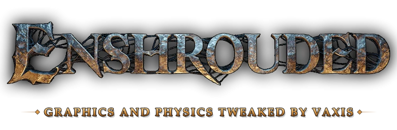

<p align="center">
  
</p>

# Extended Graphics and Physics Tweaker for Enshrouded

A set of tools that push Enshrouded past its own Ultra settings and make its world more physical. Every change can be switched back off.

Made for game patch 1.0.0.3 (build 1273043). On other builds the edits are worked out again from the installed game data. Anything that no longer matches is skipped and named in the log.

## Features

- **Physics debris.** Rubble from mining, destruction and explosions stays where it falls. You can also push it around.
- **Reactive particles:**
  - smoke, dust, embers etc moves you touch it;
  - smoke collides with walls and ceilings and slides along them;
  - optional: add volumetric smoke to every single smoke particle to the game.
- **Longer-lived effects.** Smoke lasts from 1x to 18× longer, and dust and sparks up to 8×. Effects draw up to 4× farther.
- **Fog and atmosphere:**
  - fog density, rain and snow haze, and fog glow at night and by day, all tunable.
  - thicker or thinner Shroud.
- **Bigger waves.** Swimming, moving and swimming through water make taller, longer waves. Waves last longer and travel further.
- **All lights cast shadows.** 444 more light sources cast shadows, among them spells, glowing plants and crafting stations.
- **Global illumination beyond Ultra.** Ultra+ and Ultra++ presets with up to 7.8× the ray budget, set while the game runs.
- **In-game overlay.** Ctrl+Shift+F10 shows the settings window over the game, in windowed or borderless mode.
- **Survives game updates.** Used as a Steam launch option, the mods rebuild themselves for each new game build.

## Requirements

- Windows and Enshrouded on Steam.
- [Python 3.14](https://www.python.org/downloads/) or newer on `PATH`, with tkinter (the standard installer includes it). There are no other dependencies.

## Install

1. Put this folder in the Enshrouded install folder and name it `_debris_mod`:
   `...\steamapps\common\Enshrouded\_debris_mod`.
   The tools find the game in the folder above their own.
2. Close the game. Run `graphics.bat`, pick your settings, then click **Apply to game files**.
3. Optional, when the game updates from a patch, set this as Enshrouded's launch option in Steam (Properties > General > Launch options):

   ```
   "C:\...\steamapps\common\Enshrouded\_debris_mod\autopatch.bat" %command%
   ```

   It checks the game files before every launch and rebuilds the mods when needed.
   Then remove again when the mod is up and running again.

   
4: Play.


---------ADVANCED USERS--------- Commands below are not needed for the average user/player:

## Command line
```
python -I tools\autopatch.py apply [options]   build and install the mods (options are remembered)
python -I tools\autopatch.py set [options]     save options for the next launch
python -I tools\autopatch.py status            show what is installed
python -I tools\autopatch.py restore           put the vanilla game files back
python -I tools\autopatch.py --help            list every option
python -I tools\live.py status|fog|gi          change fog and the GI preset in the running game
```

## How it works

The game data is not overwritten blindly. Every edit is checked first: each resource layout and value must match what the edit expects.

- The mods edit the resource index and data of the game: `enshrouded.kfc` and `enshrouded.kfc_resources`.
- They write their patched shaders into the `.dat` files, registered under their new content hashes.
- `enshrouded.exe` is never modified.
- `live.py` writes fog and GI values into the memory of the running game. Those changes last until the game closes.

Before the first install, the vanilla game files are backed up. They go to `_debris_mod\backup` for build 1273043, or to `_debris_mod\builds\<build>\vanilla` for other builds. Save games are never touched.

## Uninstall

1. Close the game.
2. Run `python -I tools\autopatch.py restore`.
3. Remove the launch option.

Steam's "Verify integrity of game files" also always brings back the original game.

## Disclaimer

This is an unofficial fan project. It is not affiliated with or endorsed by Keen Games. Use it at your own risk.
